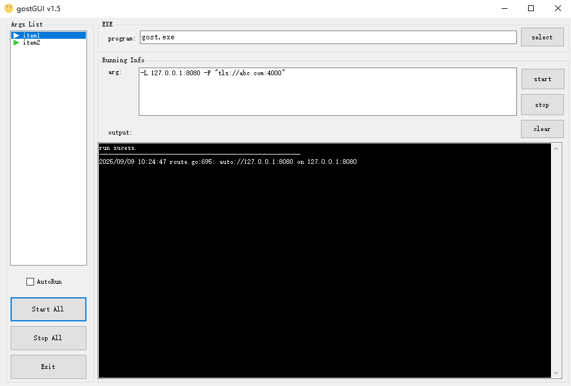

# gostGUI
A gui tool to run terminal program(for example gost.exe) on Windows.  
No need to install the program as service.   
Just  run silently in the background.

### Feature
- **Multi-Process Management**: Run and manage several command-line applications simultaneously, each with its own configuration.
- **Persistent Configurations**: All configurations are saved to a `config.json` file and reloaded on startup.
  - Add, delete, and rename configurations on-the-fly.
  - Easily edit program paths and arguments.
- **Process Control**:
  - Start and Stop individual processes.
  - Start All / Stop All enabled processes with a single click.
  - The `Enable` flag in the configuration determines if a process is included in "Start All" operations.
- **Robust Operation**:
  - Child processes run silently in the background without a visible console window.
  - **Automatic Cleanup**: All managed child processes are automatically terminated when gostGUI exits, even if it crashes, preventing orphaned processes.
- **User-Friendly Interface**:
  - **System Tray Integration**: Minimizes to the system tray to stay out of your way. Includes a tray icon context menu for quick access to major functions (Start All, Stop All, Exit).
  - **Live Status Indicators**: A visual icon in the list (▶ for running, ■ for stopped) shows the current state of each process, with colors that adapt to selection for clarity.
  - **Per-Process Logging**: View real-time console output for each application in its own dedicated log window, which includes startup, shutdown, and exit code information.
  - **Easy Configuration**: Supports drag-and-drop for setting the executable file path.
- **Windows Integration**:
  - Option to automatically start with Windows.
  

### Screen

### How to use
- place the .exe file with gostGUI.exe
- select program and type args in textbox
- press start button.  

### Configuration (`config.json`)

`gostGUI` saves its settings in a `config.json` file in the same directory.
- `Name`: The unique name for the configuration.
- `Program`: The path to the executable.
- `Args`: The command-line arguments.
- `Enable`: A boolean (`true`/`false`) that determines if this configuration is started by "Start All". This is automatically updated when you start or stop a process.

### Change log
- **v1.8**:
  - 允许在进程运行状态下直接重命名左侧列表显示名称，将界面显示与配置对象引用解耦（无需额外增加冗余 key 字段）。
  - 优化托盘双击与前台激活机制，移除易引发跨线程死锁的 `AttachThreadInput`，采用安全的 `keybd_event` 与 `TopMost` 机制，保证被其他窗口遮挡时可靠置顶且绝不死锁。
  - 修复多处极端情况下的程序卡死与界面冻结问题：
    - 日志追加改用非阻塞 `BeginInvoke`，避免后台进程输出日志时阻塞工作线程与主线程死锁。
    - 日志行数检测改用原生 Win32 `EM_GETLINECOUNT` 消息，消除原 `TextBox.Lines.Length` 频繁分配大数组导致的严重界面卡顿。
    - `ProcessManager` 内部多进程集合全面增加线程同步锁，避免并发修改导致 `Dictionary` 损坏或死循环卡死。
    - 增加 `config.json` 写入线程锁，避免并发保存产生文件读写冲突。
  - 修复 `AutoRun` 复选框功能：点击界面上的 `AutoRun` 即可实时更新并保存 `config.json` 中的 `"autoRun"` 配置项；启动 gostGUI 时根据该配置决定是否自动运行已启用的程序，移除原先混淆的注册表弹窗代码。
  - 程序主窗口标题更新为 `gostGUI v1.8`，程序集与文件版本升级至 `1.8`。
- **v1.6**: Click listbox to start/stop program.
- **v1.5**: Implemented robust multi-process management and automatic child-process cleanup on exit. Revamped UI with custom-drawn status icons and improved in-place editing. (Thanks to Gemini Code Assist).
- **v1.2**: Added "Run on system startup" functionality.
- **v0.1**: Initial release with support for multiple argument configurations.

